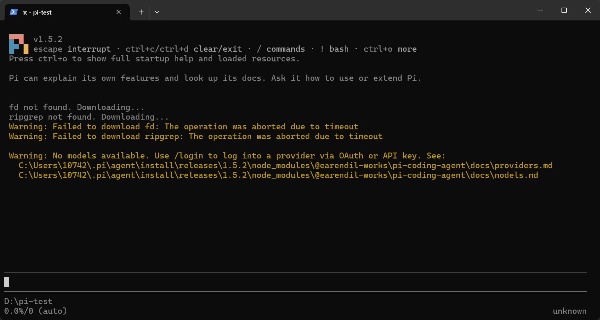
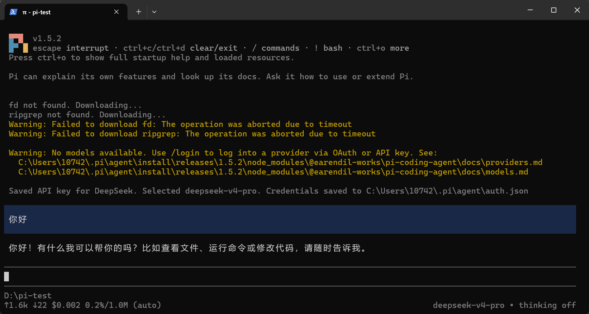
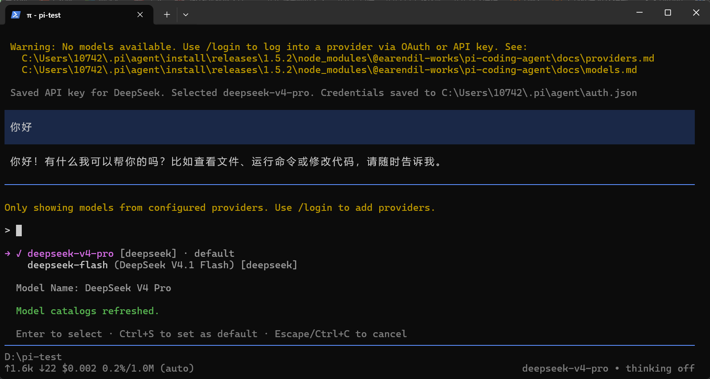
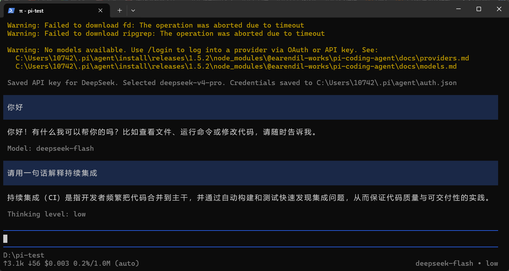
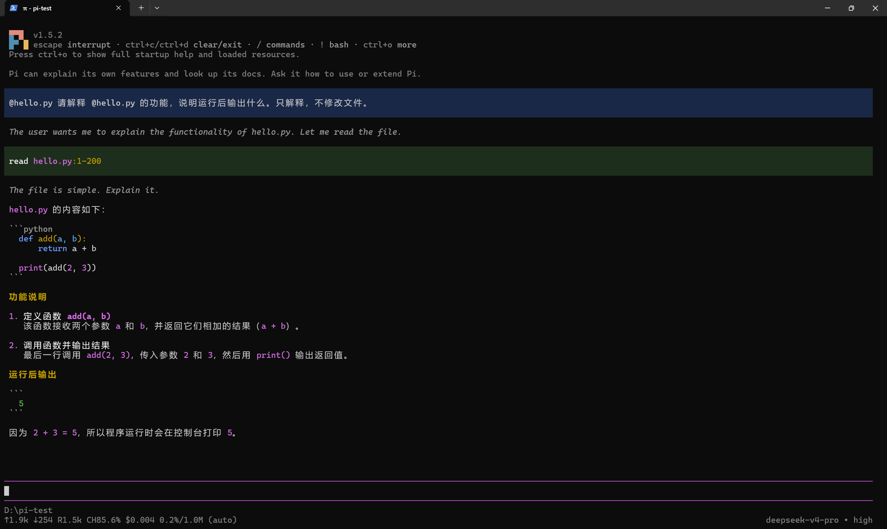
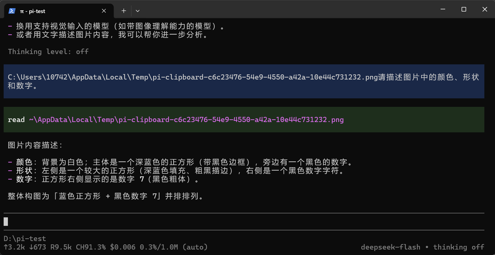
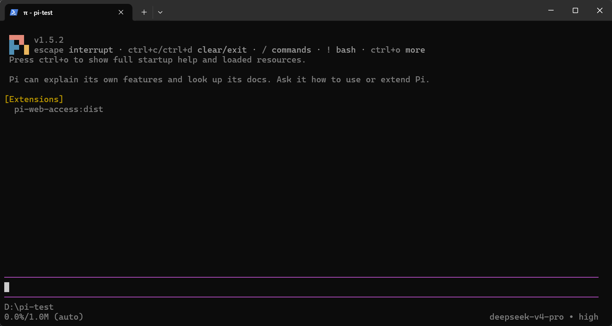
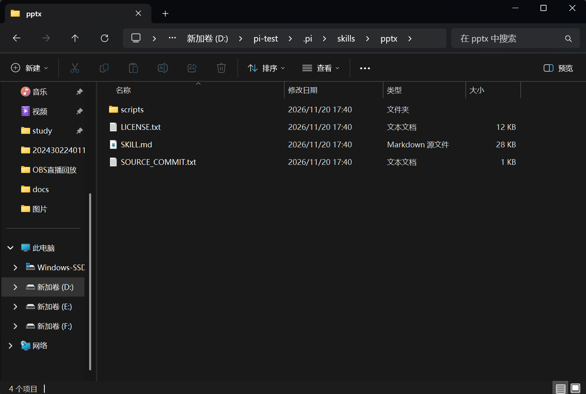
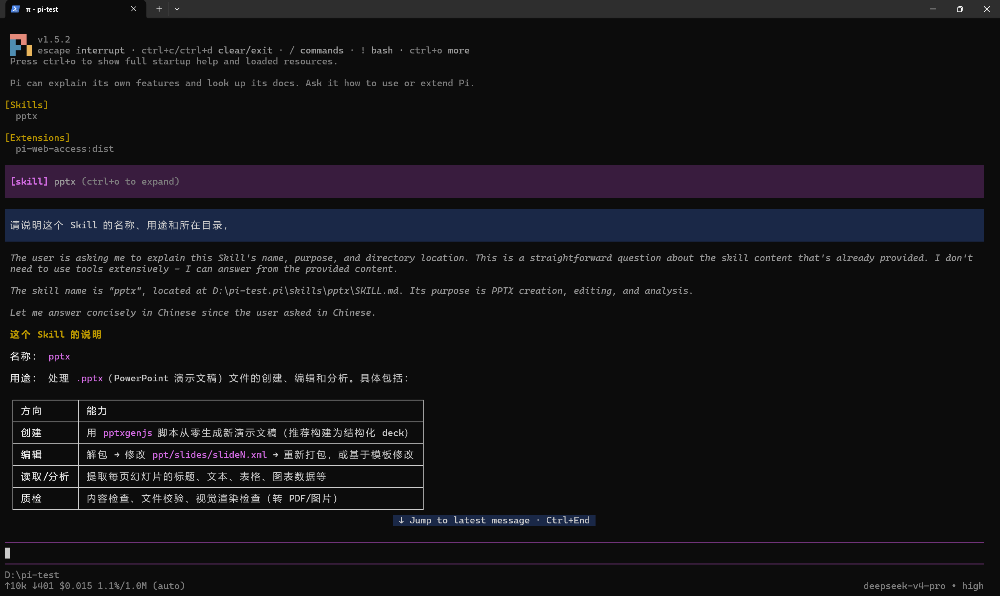

# 实践课 1：Pi Agent 安装与使用

## 任务完成情况

| 序号 | 任务 | 完成情况 | 截图 |
|---|---|---|---|
| 1 | 本地安装并启动 Pi | 完成 | S1 |
| 2 | 配置模型并完成一次会话 | 完成 | S2 |
| 3 | 切换模型与模型思考级别 | 完成 | S3-1、S3-2 |
| 4A | 使用 @ 引用代码文件 | 完成 | S4 |
| 4B | 粘贴小图片并测试 | 完成 | S5 |
| 5 | 安装并试用 Pi 插件（pi-web-access） | 完成 | S6 |
| 6 | 让 AI 安装 PPT Skill（选做） | 完成安装、发现与调用 | S7、S8 |

### 任务一 本地安装并启动

### 任务二 配置模型并完成一次会话

使用 DeepSeek API Key 方式登录。

### 任务三 切换模型与思考级别

### 任务四 引用代码并粘贴小图片

**A 使用 @ 引用代码文件**

**B 粘贴小图片并测试**

原始测试图片：

### 任务五 安装并使用一个插件

| 项目 | 内容 |
|---|---|
| 名称 | pi-web-access |
| 来源 | npm `pi-web-access`，https://github.com/nicobailon/pi-web-access |
| 安装命令 | `pi install npm:pi-web-access -l` |
| 作用 | 网页搜索、URL 抓取、GitHub 仓库克隆、PDF 提取、视频理解 |
| 所需配置 | 零配置可用（默认 Exa MCP），可选配置各家搜索 API key |

### 任务六 安装 PPT Skill（选做）

| 项目 | 内容 |
|---|---|
| 安装位置 | `D:\pi-test\.pi\skills\pptx` |
| 文件数 | 59 个 |
| 源 commit | e4bb5d960d87126ff3b3a8af1a104b7db67560ba |

